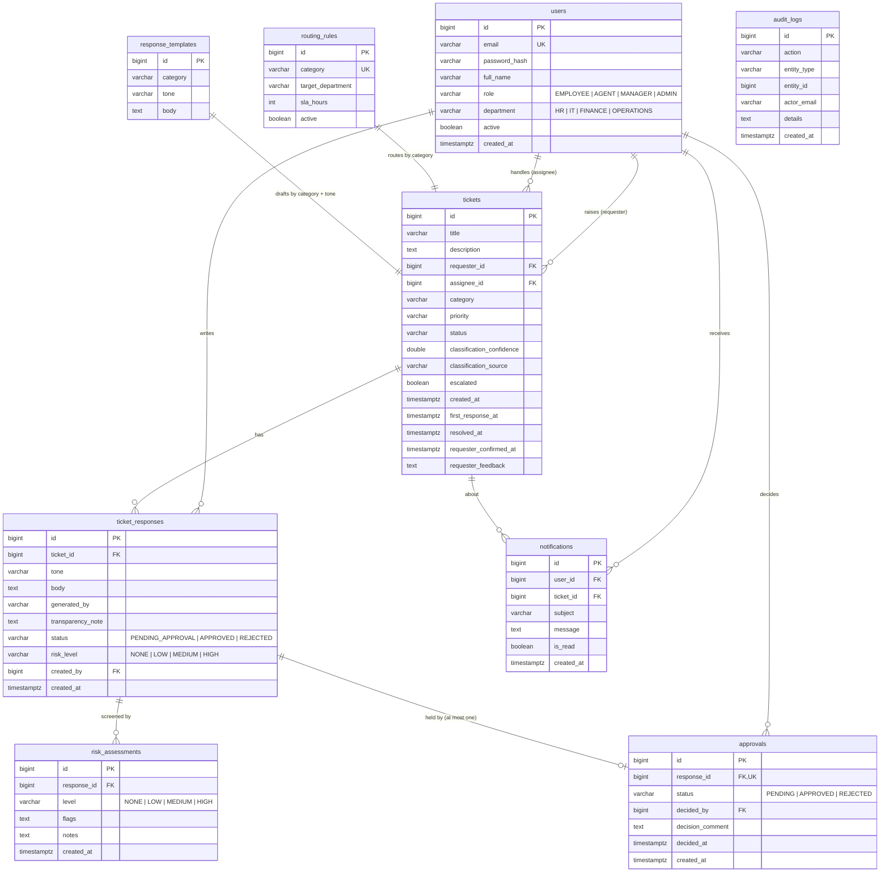

# Entity Relationship Diagram

Schema is owned by Flyway migrations in `backend/src/main/resources/db/migration/`.
Hibernate never changes it (`spring.jpa.hibernate.ddl-auto: none`).

## Migration history

| Version | File | Purpose |
|---------|------|---------|
| V1 | `V1__init_schema.sql` | core tables and base indexes |
| V2 | `V2__seed_templates_and_rules.sql` | 12 response templates + 4 routing rules |
| V3 | `V3__schema_improvements.sql` | `users.active`, case-insensitive email, composite indexes |
| V4 | `V4__requester_resolution_confirmation.sql` | requester confirmation columns + index |
| V5 | `V5__ticket_state_and_optimistic_locking.sql` | optimistic locking, unique approval per response |
| V6 | `V6__hot_path_indexes.sql` | reporting/approval/notification indexes |
| V7 | `V7__enum_check_constraints.sql` | CHECK constraints for enum columns |

## Key invariants

1. One response can have **at most one** approval (unique index `uq_approvals_response_id`).
2. A ticket can have **at most one pending approval** at a time (enforced in `ResponseService`).
3. Risk assessments are append-only; the newest row per response is the effective level.
4. `approvals.decided_at` is null until a manager decides.
5. Every write path is audited in `audit_logs`.

## Index rationale

| Index | Backs |
|-------|-------|
| `idx_tickets_status_created` | ticket list filtered by status, newest first |
| `idx_tickets_requester_created` | an employee's own ticket list |
| `idx_responses_ticket` | the reply thread on a ticket detail page |
| `idx_approvals_status_created_at` | approvals list per status |
| `idx_approvals_decided_at` | approved/rejected counts in compliance report |
| `idx_assessments_created_at` | risk report window |
| `idx_notifications_user_created_at` | unread badge poll every 30 s |
| `idx_tickets_status_escalated` | SLA escalation sweep every 15 min |
