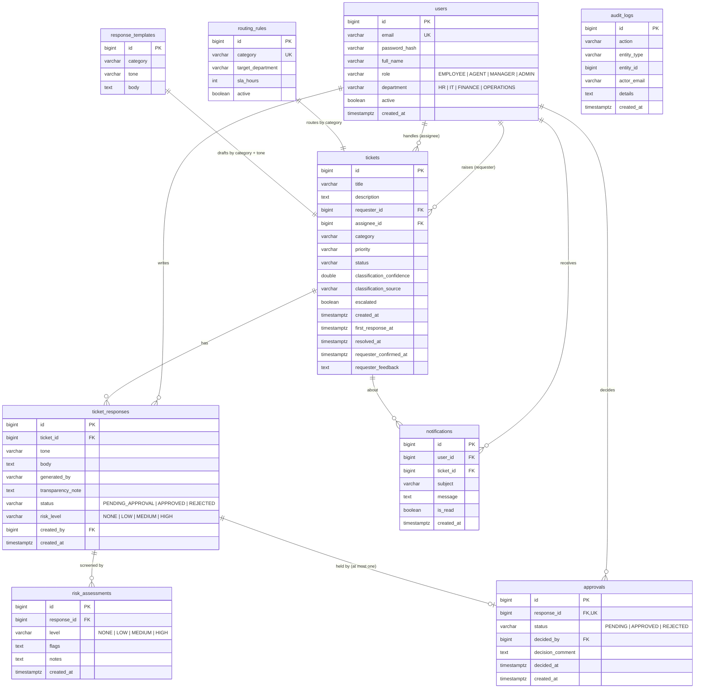

# Database Tasks

Owner: Database developer. Your files are:

- `backend/src/main/resources/db/migration/` — schema only, **additive**
- `backend/src/main/java/com/capaciti/ops/config/DataSeeder.java` — demo data (optional)
- `docs/ERD.md` — new documentation file

Read `docs/team/WORKFLOW.md` first. Branch off `main`:

```bash
git fetch origin
git switch main && git pull --ff-only origin main
git switch -c feat/hot-path-indexes
```

---

## The one rule you enforce

**Never edit an existing `V*.sql` file.** Flyway stores a checksum for each applied
migration; editing one makes startup fail on every existing database with
`Validate failed: migration checksum mismatch`. New change = new file with the next
number. The current latest is `V5__ticket_state_and_optimistic_locking.sql`, so your
first file is `V6__…sql`.

The application never creates schema (`ddl-auto: none` in `application.yml`) — only
your migrations do.

---

## Task 1 — `V6__hot_path_indexes.sql`

**Why:** the compliance report, the approvals list and the notification badge filter on
columns that have no matching index yet, so those queries scan whole tables once the
demo data grows.

**New file:** `backend/src/main/resources/db/migration/V6__hot_path_indexes.sql`

```sql
-- Hot-path indexes for reporting, approvals and notifications.
-- Additive only: V1..V5 are applied everywhere and must never be edited.

-- ComplianceService.overview() and report() load risk assessments for a time window.
CREATE INDEX IF NOT EXISTS idx_assessments_created_at
    ON risk_assessments(created_at);

-- UserController counts responses written by a user before deleting the account.
CREATE INDEX IF NOT EXISTS idx_responses_created_by
    ON ticket_responses(created_by);

-- ApprovalService.list() and countByStatus* order/filter by status then time.
CREATE INDEX IF NOT EXISTS idx_approvals_status_created_at
    ON approvals(status, created_at);

-- ComplianceService counts approved/rejected decisions inside a date window.
CREATE INDEX IF NOT EXISTS idx_approvals_decided_at
    ON approvals(decided_at);

-- Layout.tsx polls the newest notifications for one user every 30 seconds.
CREATE INDEX IF NOT EXISTS idx_notifications_user_created_at
    ON notifications(user_id, created_at DESC);

-- WorkflowService.escalateOverdue() selects open, not-yet-escalated tickets.
CREATE INDEX IF NOT EXISTS idx_tickets_status_escalated
    ON tickets(status, escalated);
```

Notes for the reviewer (put these in the PR description):

- `idx_approvals_status` from V1 is now covered by the composite
  `(status, created_at)` for ordered reads; keep it, it is harmless.
- `IF NOT EXISTS` makes the file safe if someone re-runs it by hand.

### Verify

```bash
make up

# apply migrations by starting the backend with the dev profile
make backend
# watch the log for: "Migrating schema \"public\" to version 6 - hot path indexes"

docker compose exec postgres psql -U ops -d opsdb \
  -c "select version, description, success from flyway_schema_history order by installed_rank;"

docker compose exec postgres psql -U ops -d opsdb \
  -c "select tablename, indexname from pg_indexes where schemaname = 'public' order by 1, 2;"
```

All six new indexes must be listed and `flyway_schema_history` must end with
`6 | hot path indexes | t`.

### Commit

```bash
git add backend/src/main/resources/db/migration/V6__hot_path_indexes.sql
git commit -m "perf(db): add indexes for compliance, approval and notification queries"
git push -u origin feat/hot-path-indexes
```

---

## Task 2 — `V7__enum_check_constraints.sql`

**Why:** every enum column is a plain `VARCHAR`. A typo in code (`"IN-PROGRESS"`) is
stored happily and then breaks filtering and colour mapping. Database-level CHECK
constraints make bad values impossible.

**New file:** `backend/src/main/resources/db/migration/V7__enum_check_constraints.sql`

```sql
-- Enforce the enum vocabularies at the database boundary.
-- Values mirror the Java enums in com.capaciti.ops.ticket / response / compliance / user.

ALTER TABLE tickets
    ADD CONSTRAINT chk_tickets_status
    CHECK (status IN ('NEW', 'ASSIGNED', 'IN_PROGRESS', 'AWAITING_APPROVAL', 'RESOLVED', 'CLOSED'));

ALTER TABLE tickets
    ADD CONSTRAINT chk_tickets_priority
    CHECK (priority IN ('LOW', 'MEDIUM', 'HIGH', 'URGENT'));

ALTER TABLE tickets
    ADD CONSTRAINT chk_tickets_category
    CHECK (category IN ('HR', 'IT', 'FINANCE', 'OPERATIONS'));

ALTER TABLE ticket_responses
    ADD CONSTRAINT chk_responses_status
    CHECK (status IN ('PENDING_APPROVAL', 'APPROVED', 'REJECTED'));

ALTER TABLE ticket_responses
    ADD CONSTRAINT chk_responses_risk_level
    CHECK (risk_level IN ('NONE', 'LOW', 'MEDIUM', 'HIGH'));

ALTER TABLE ticket_responses
    ADD CONSTRAINT chk_responses_tone
    CHECK (tone IN ('FORMAL', 'FRIENDLY', 'URGENT'));

ALTER TABLE approvals
    ADD CONSTRAINT chk_approvals_status
    CHECK (status IN ('PENDING', 'APPROVED', 'REJECTED'));

ALTER TABLE risk_assessments
    ADD CONSTRAINT chk_assessments_level
    CHECK (level IN ('NONE', 'LOW', 'MEDIUM', 'HIGH'));

ALTER TABLE users
    ADD CONSTRAINT chk_users_role
    CHECK (role IN ('EMPLOYEE', 'AGENT', 'MANAGER', 'ADMIN'));
```

### Pre-flight check — run this first

A constraint fails if existing rows violate it. Run these on your dev database
(**before** writing the migration into the shared branch):

```sql
SELECT DISTINCT status   FROM tickets;
SELECT DISTINCT priority FROM tickets;
SELECT DISTINCT category FROM tickets;
SELECT DISTINCT status   FROM ticket_responses;
SELECT DISTINCT risk_level FROM ticket_responses;
SELECT DISTINCT tone     FROM ticket_responses;
SELECT DISTINCT status   FROM approvals;
SELECT DISTINCT level    FROM risk_assessments;
SELECT DISTINCT role     FROM users;
```

Every value must appear in the matching list above. If you find junk, fix it in the
migration **before** adding the constraint, for example:

```sql
UPDATE tickets SET status = 'NEW' WHERE status NOT IN ('NEW','ASSIGNED','IN_PROGRESS','AWAITING_APPROVAL','RESOLVED','CLOSED');
```

(Only do this if the pre-flight query actually finds bad rows.)

### Verify

```bash
docker compose down -v      # clean database, so Flyway runs V1..V7 from scratch
make up
make backend

docker compose exec postgres psql -U ops -d opsdb \
  -c "select conname, pg_get_constraintdef(oid) from pg_constraint where conname like 'chk_%' order by 1;"

# prove it rejects a bad value (must fail with a check violation):
docker compose exec postgres psql -U ops -d opsdb \
  -c "insert into users (email, password_hash, full_name, role) values ('x@x','x','X','WIZARD');"
```

The insert must fail. Also run the integration suite, because it exercises real
migrations against Testcontainers:

```bash
make it
```

### Commit

```bash
git add backend/src/main/resources/db/migration/V7__enum_check_constraints.sql
git commit -m "feat(db): enforce enum vocabularies with check constraints"
```

---

## Task 3 — `docs/ERD.md`

**Why:** the team has no single place that explains the schema, the indexes and why the
migrations exist. This is the document a reviewer or lecturer will look for.

**New file:** `docs/ERD.md`

````markdown
# Entity Relationship Diagram

Schema is owned by Flyway migrations in `backend/src/main/resources/db/migration/`.
Hibernate never changes it (`spring.jpa.hibernate.ddl-auto: none`).



## Migration history

| Version | File | Purpose |
|---------|------|---------|
| V1 | `V1__init_schema.sql` | core tables and base indexes |
| V2 | `V2__seed_templates_and_rules.sql` | 12 response templates + 4 routing rules |
| V3 | `V3__schema_improvements.sql` | `users.active`, case-insensitive email, composite indexes |
| V4 | `V4__requester_resolution_confirmation.sql` | requester confirmation columns + index |
| V5 | `V5__ticket_state_and_optimistic_locking.sql` | optimistic locking, unique approval per response |
| V6 | `V6__hot_path_indexes.sql` | reporting/approval/notification indexes |
| V7 | `V7__enum_check_constraints.sql` | CHECK constraints for enum columns |

## Key invariants

1. One response can have **at most one** approval (unique index `uq_approvals_response_id`).
2. A ticket can have **at most one pending approval** at a time (enforced in `ResponseService`).
3. Risk assessments are append-only; the newest row per response is the effective level.
4. `approvals.decided_at` is null until a manager decides.
5. Every write path is audited in `audit_logs`.

## Index rationale

| Index | Backs |
|-------|-------|
| `idx_tickets_status_created` | ticket list filtered by status, newest first |
| `idx_tickets_requester_created` | an employee's own ticket list |
| `idx_responses_ticket` | the reply thread on a ticket detail page |
| `idx_approvals_status_created_at` | approvals list per status |
| `idx_approvals_decided_at` | approved/rejected counts in compliance report |
| `idx_assessments_created_at` | risk report window |
| `idx_notifications_user_created_at` | unread badge poll every 30 s |
| `idx_tickets_status_escalated` | SLA escalation sweep every 15 min |
````

### Verify

- The Mermaid block renders on GitHub (check the branch preview).
- Every table and column you list exists: compare against the migrations.
- The migration table matches the actual files in `db/migration/`.

### Commit

```bash
git add docs/ERD.md
git commit -m "docs(db): add entity relationship diagram and migration history"
git push -u origin feat/hot-path-indexes
```

---

## Boundaries

- You own migrations. Do not edit Java outside `DataSeeder.java`.
- If a change needs a new column on an entity, coordinate with the backend lead: they
  add the field to the JPA entity, you add the column in a new migration.
- Do not commit database dumps or the local `ops-pgdata` volume.
